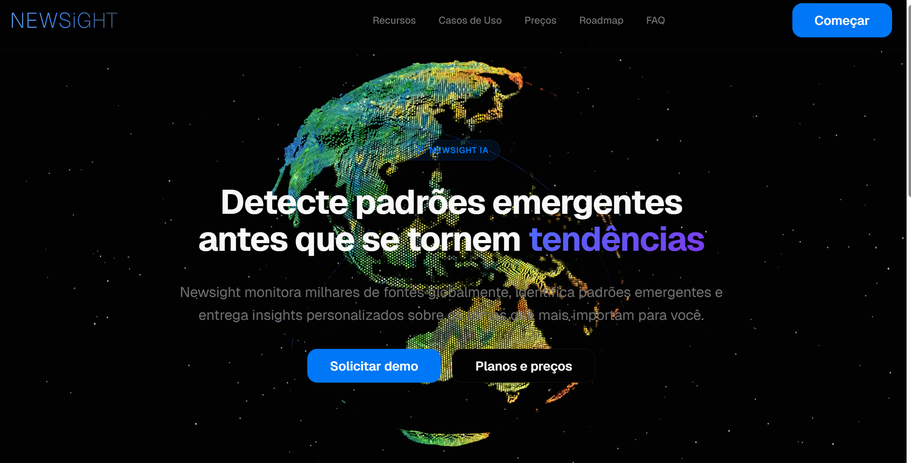

<h1 align="center">Douglas Oliveira</h1>

Backend Developer (C# / .NET) · Mechatronics Engineer, Brazilian Navy

  <a href="#about">About</a> •
  <a href="#career">Career</a> •
  <a href="#stack">Stack</a> •
  <a href="#projects">Projects</a> •
  <a href="#contact">Contact</a>

<i>"...ut per rivulos, non statim in mare, eligas introire, quia per faciliora ad difficiliora oportet devenire."</i> — St. Thomas Aquinas, Epistola de Modo Studendi

---

<h3 id="about">About</h3>

Backend developer working mainly with C# / .NET, following Clean Architecture principles to keep services modular and maintainable. Also comfortable across the stack — Blazor, React, BFF layers, RESTful APIs — and occasionally down to hardware/firmware. Background in Mechatronics Engineering and current work as a technical officer with the Brazilian Navy gives me a systems-level view of software: breaking things down into clear, testable parts, regardless of the layer.

<h3 id="career">Career</h3>

**Research Assistant** · University of São Paulo (USP)
Contributed to embedded systems and numerical methods research, including work on [NavShieldTracer](https://github.com/DouglasOliveiraC/NavShieldTracer), an open-source dynamic analysis tool for real-time monitoring of sensitive applications.

**Technical Officer — Research & Innovation** · ITI (Instituto de Tecnologia da Marinha do Brasil)
Working on applied robotics for the Brazilian Navy: an **expeditionary robotics platform** — low-level C programming, sensor/actuator control, and system integration for a field-deployed robotic unit.

<h3 id="stack">Stack</h3>

**Backend**

  
  
  

**Frontend**

  
  

**Systems / Embedded**

  
  
  

**Cloud / Tooling**

  
  
  

<h3 id="projects">Projects</h3>

<table>
  <tr>
    <td width="33%">
<b>NewSight</b> News-to-knowledge-graph platform · .NET 8, Azure Functions, PostgreSQL + pgvector
</td>
    <td width="33%">
<b>NavShieldTracer</b> Dynamic analysis for real-time monitoring of sensitive applications
</td>
    <td width="33%">
<b>CofrePIC</b> Electronic safe on a PIC16F886 · matrix keypad, 7-segment display, stepper motor · C / XC8, MPLAB X
</td>
  </tr>
</table>

<h3 id="contact">Contact</h3>

  
  

---

  

